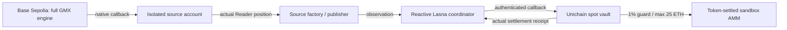

# Hedge Pact

**Keep both sides of the pact.** A Reactive-powered hedge integrity sandbox for strategies with a spot leg on one chain and a perpetual short on another.

When ADL closes a profitable short, the spot leg can remain exposed. Hedge Pact reads the actual remaining GMX position, authenticates a cross-chain policy decision, sells a bounded quantity of spot, and acknowledges the tokens that actually settled.

Built for the Reactive Omni Buildathon, **Set It and Forget It**. Hyperliquid's xyz:SKHYNIX incident is the motivating narrative. This implementation uses a pinned full GMX engine in a testnet sandbox; it does not integrate with Hyperliquid.

**[Open the app](https://hedge-pact.release-worried7z.chatgpt.site)** · [Verified public receipts](app/public/proof.json)

Public run: native GMX short **100 → 60 ETH**, spot **100 → 60 ETH**, **99,660.227478 hpUSD** received through real token transfers, followed by a sequence-bound Reactive acknowledgement. These are synthetic test assets, not economic profit.

## Run it

Requires Node 22, Python 3.12, Foundry with Solidity 0.8.29.

```sh
npm ci --prefix app
npm run setup:gmx
npm run build:contracts
npm run test:contracts
npm run test:gmx
npm run export:abi
npm run dev
```

Full GMX compilation takes several minutes and substantial memory. Dependency installation uses `--ignore-scripts --legacy-peer-deps` to match the upstream ethers-v5 stack. The application has a separate viem/wagmi dependency tree. No private key is needed to build, inspect the replay, or use the browser app.

Optional browser verification (with the dev server running):

```sh
cd app
npx playwright install chromium
node test-ui.mjs
node test-hosted.mjs
```

Set `PLAYWRIGHT_CHROMIUM_EXECUTABLE` to use an existing Chromium installation.

## Self-service flow

1. Connect an injected browser wallet funded on Base Sepolia and Unichain Sepolia.
2. Create an isolated source account, market, and synthetic assets.
3. Seed and execute the GMX liquidity deposit; open and execute the short.
4. Create your spot vault on Unichain. Reactive verifies matching owner/source/expiry before binding it.
5. Arm the strategy, prepare the spot market context, and trigger native GMX ADL.
6. Inspect actual spot reduction and receipts. The protective response continues after closing the browser.

Sessions last 15 minutes from source creation, with three concurrent leases and at most 20 source observations per strategy. All displayed assets are synthetic test tokens. GMX fee WNT is backed by deposited native testnet ETH.

## Architecture



The short is reduce-only while armed. Delayed observations cannot reintroduce a larger hedge after a newer reduction. The destination retains its actual balances and local price guards; it never substitutes a local perpetual position for the remote position.

## Evidence and limits

- [Native short lifecycle](evidence/native-short.json): local full GMX short, native partial ADL, ordinary close.
- [Contract tests](evidence/contracts-tests.log): authentication, delivery ordering, isolation, stale data, quarantine, recovery, bounded retries, settlement, expiry, and withdrawal.
- [Deployment manifest](deployments/manifest.json), [preflight](evidence/preflight.json), [public proof](app/public/proof.json).
- [Architecture](docs/architecture.md), [security and limits](docs/security.md), [demo](docs/demo.md).

A successful testnet run demonstrates interoperability and policy execution. It does **not** prove a speed advantage, production oracle independence, profitability, or prevention of historical losses. Earlier paired testing found the keeper faster in all 98 completed pairs; this negative finding is retained.

## Provenance

GMX Synthetics: [`a85ea3491c19c93bb4b5a002d9b358fb769b7849`](https://github.com/gmx-io/gmx-synthetics/tree/a85ea3491c19c93bb4b5a002d9b358fb769b7849). Upstream BUSL-1.1 and per-file notices remain intact. The fixture records constructor bytecode, libraries, ABI and configuration from the compiled engine. The deployer remaps dependencies; it does not substitute a custom venue.

Our code outside `vendor` is MIT licensed. Dependencies retain their own notices. This is an unaudited testnet MVP.

## Hosting

The public artifact is hosted with Sites. GitHub Actions builds the same application from its lockfile. GitHub Pages inherits an unresolved custom domain from the account, so its account-wide domain settings were preserved. [Hosting identity](deployments/hosting.json) records the existing Site; updates must reuse that project rather than creating another one.
